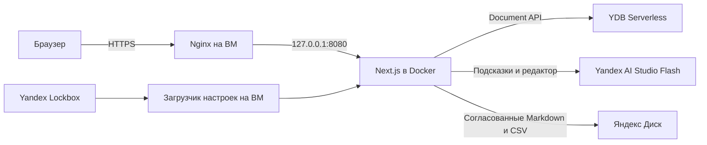

# Канон кампуса «Южный Урал»

Техническая документация и итоги работы за 20–21 ноября 2026 года. Состояние проверено 21 ноября по местному времени Екатеринбурга.

**Текущий выпуск — 0.9.0, внутренний пилот.** [Открыть Канон](https://51.250.46.79/). На сервере работает коммит `8aa0b2d` из ветки `release/kanon-flash-assist`. Номер версии виден в подвале. По этому адресу можно показать интерфейс, поиск, «Светофор» и аналитику. Для показа заполненного справочника и полного согласования есть изолированная демонстрационная среда. При проверке рабочей выдачи сервер вернул 0 опубликованных карточек и 0 статей.

## 1. Задача проекта

Семь вузов и другие участники кампуса готовят материалы для СМИ, сайтов и социальных сетей. Цифра может относиться к кампусу целиком, одному вузу, отдельной очереди строительства или конкретному году. «Канон» собирает согласованные факты и источники, чтобы автор мог найти нужное значение, открыть первоисточник, проверить черновик, подготовить публикацию и согласовать её.

В проекте два уровня материалов.

1. **Утверждённые карточки.** Источник проверяемых фактов, цифр, дат, статусов и авторства. Первая карточка может описывать кампус целиком, вторая — паспорт вуза, третья — лабораторию или совместный проект.
2. **Согласованные статьи.** Библиотека формулировок и смысловых блоков для редактора. Фактические утверждения в материале привязаны к карточкам-источникам.

Справочник рассчитан на ЮУрГУ, ЧелГУ, МИДиС, ЮУГМУ, ЮУрГАУ, МГТУ им. Г. И. Носова и ЮУрГГПУ. В модели данных предусмотрены проекты и продукты, лаборатории и инфраструктура, паспорта, партнёрства, спикеры, метрики и дополнительные типы карточек.

## 2. Что умеет сервис

| Раздел | Что можно сделать |
| --- | --- |
| Главная и поиск | Найти карточку по запросу, перейти к вузу, паспорту кампуса или рабочему инструменту. Поиск показывает совпавшие фрагменты и ведёт к карточке. |
| Справочник | Просматривать дерево папок, карточки, источники и связанные записи, скачивать Markdown. Сотрудники с правами могут создавать и править карточки. |
| Карточки и модерация | Подать новую карточку или правку, подтвердить участие в совместном проекте, согласовать либо отклонить изменение. При редактировании утверждённой карточки в общей выдаче сохраняется её согласованная версия. |
| Конструктор типов | Добавлять доступные администратору типы карточек и их поля без переписывания интерфейса для каждого типа. |
| «Светофор» | Вставить текст, увидеть подтверждённые факты, расхождения и утверждения для ручной сверки. По замечанию можно открыть карточку-источник, если она найдена. Есть переписывание по канону и отдельная кнопка подсказок Flash. |
| Аналитика | Сформулировать запрос, проверить распознанные критерии, получить таблицу и количество найденных карточек. Поддерживаются отбор по вузу, типу, отрасли, партнёру, стадии, контуру и совместным проектам. |
| Редактор | Собрать черновик по карточкам с источниками, отредактировать текст и варианты подачи, запустить проверку, подготовить SEO/GEO-формулировки и скачать DOCX. Сотрудник может направить выбранную редакцию на согласование. |
| Готовые статьи | Открывать согласованные материалы с привязкой к исходным карточкам. После утверждения статья попадает в библиотеку и в процесс выгрузки на Диск. |
| Запросы | Запросить у другого участника сведения или исправление. Получатель отвечает и при необходимости передаёт карточку на согласование. Видимость запроса, черновиков и связанных карточек определяется правами участника. |
| Состояние | Проверить работу процесса, готовность базы и наличие настроек подключённых интеграций через технические маршруты. |

В главной применён выбранный вариант «Единая полоса» с поиском и горизонтальной навигацией. На маленьком экране ссылки переходят в компактную сетку. Индикатор меню плоский. Декоративный градиент наведения у карточек главной убран. В аналитике число и полоса показателя разнесены, чтобы цифра читалась на широком и узком экранах.

## 3. Архитектура и стек

**Приложение и API работают в одном проекте Next.js.** Браузер получает серверные страницы и интерактивные React-компоненты. Запросы к карточкам, проверке, аналитике, черновикам и авторизации обрабатывают маршруты `app/api`. Доступ к хранилищу и интеграциям выполняет серверный код.

| Слой | Технологии и назначение |
| --- | --- |
| Приложение | Node.js 24 внутри образа, Next.js 16.4.6 с App Router, React 19, TypeScript 6 и Turbopack для сборки. |
| Интерфейс | Tailwind CSS 4, CSS проекта, компоненты shadcn/Base UI, Lucide для иконок, Sonner для уведомлений. |
| Контракты данных | Zod 4 проверяет входные структуры API, текстовые лимиты и допустимые действия. |
| Постоянное хранилище | Yandex Managed Service for YDB Serverless. Document API совместим с протоколом DynamoDB, поэтому код использует AWS SDK для DynamoDB. |
| ИИ | Yandex AI Studio с моделью Alice AI LLM Flash, URI модели содержит `aliceai-llm-flash`. Проверка и аналитика имеют локальный движок. |
| Файлы и выгрузки | JavaScript создаёт Markdown и CSV, библиотека `docx` формирует Word, REST API отправляет резервные файлы на Яндекс Диск. |
| Хостинг и сеть | Yandex Compute Cloud, Ubuntu, Docker Engine, Docker Compose, systemd, Nginx, Let's Encrypt, UFW, Fail2ban. Публичный HTTPS сейчас работает по статическому IPv4. |
| Проверки | ESLint, TypeScript, `tsx`, Node Test Runner, Playwright, одноразовая DynamoDB Local и GitHub Actions. |

**Рабочая среда** использует облачную YDB. Если база недоступна, приложение сообщает о проблеме с хранилищем. **Локальное демо** включается отдельно и может использовать встроенный корпус и локальный файл. **Одноразовая среда приёмки** использует DynamoDB Local в памяти с той же схемой и тестовыми ролями. Она нужна для сквозных проверок записи, согласования и разграничения прав.

### Где искать код

| Путь | Назначение |
| --- | --- |
| `app/` и `components/` | Страницы, общий макет с версией, пользовательские формы, таблицы и компоненты. |
| `app/api/` | HTTP-операции для чтения, записи, входа и интеграций. |
| `lib/knowledge.ts`, `lib/knowledge-lifecycle.ts`, `lib/models.ts` | Типы карточек, дерево папок, согласованные версии и доступ к данным. |
| `lib/fact-check.ts`, `lib/audit-canon-registry.ts` | Правила проверки, поиск опоры и контрольные разночтения. |
| `lib/analytics.ts` | Разбор запроса, фильтрация, расчёт показателей и построение таблицы. |
| `lib/editor.ts`, `lib/editorial.ts`, `lib/editorial-models.ts` | Подготовка текста, редакционный процесс, согласование и ревизии. |
| `lib/flash-assist.ts` и `lib/yandex-ai.ts` | Разрешение на запрос Flash, ограничения, проверка ответа и клиент AI Studio. |
| `lib/auth.ts`, `lib/auth-server.ts`, `lib/pilot-auth.ts` | Модель ролей, персональные аккаунты, сессия и серверные проверки. |
| `lib/yandex-disk.ts` и `lib/disk-sync-service.ts` | Форматы выгрузки, дерево папок, отправка и состояние копий. |
| `lib/db.ts`, `lib/schema.ts` | Настройка клиента YDB и схемы таблиц. |
| `deploy/`, `Dockerfile` | Образ, Compose, проверка конфигурации, тестовые среды и инструкции восстановления. |
| `scripts/` и `.github/workflows/ci.yml` | Миграции, импорт, тесты и автоматические проверки. |

Эта карта описывает развёрнутую ветку `release/kanon-flash-assist`. Основная рабочая копия содержит также план, аудит и историю работы.

## 4. Данные и жизненный цикл

Все шесть таблиц хранят записи с ключом `id`. В текущей версии схема приложений описана в `lib/schema.ts`.

| Таблица | Что хранит |
| --- | --- |
| `knowledge-cards` | Карточки, факты, связи, источники, статусы, согласованный снимок и метаданные выгрузки. |
| `knowledge-card-types` | Настраиваемые типы карточек и их поля. |
| `knowledge-articles` | Согласованные статьи и связанные карточки-источники. |
| `editorial-documents` | Состояние каждого черновика, автор, направленная ревизия и согласованная версия. |
| `editorial-revisions` | Содержимое версий и события редакционного процесса. |
| `information-requests` | Запросы между участниками, ответы и связанные изменения карточек. |

В карточке указываются владелец, вуз, тип и контур, источник и состояние согласования. Для показателя важны единица измерения, дата или год, область применения и статус факта либо плана. Для совместного проекта система хранит одну запись и связи с вузами. Переходы к ней доступны из нужных папок.

Типовой цикл карточки.

1. Автор создаёт черновик с источником или предлагает правку опубликованной карточки.
2. При совместной работе нужные участники подтверждают участие. Согласующий проверяет факты и карточку.
3. Согласованная версия становится доступна справочнику, поиску, «Светофору», аналитике и редактору с учётом прав.
4. Приложение формирует и выгружает Markdown и CSV. Ошибка выгрузки отражается в состоянии записи, доступен отдельный повтор.
5. При новой правке автор работает с черновиком. Инструменты продолжают брать факты из предыдущей утверждённой версии до следующего согласования.

Импорт стартовой базы является операторским действием. `npm run db:import-approved-knowledge` проверяет подготовленный набор, поддерживает предварительную проверку и добавляет согласованные записи без автоматической подстановки локальных демонстрационных данных. Процедура описана в [инструкции развёртывания](DEPLOY.md).

## 5. Как работают «Светофор», Flash и аналитика

**«Светофор»** загружает канонические версии карточек и проверяет текст штатными правилами приложения. Движок учитывает тип факта и его контекст, например год, единицу измерения, автора, принадлежность к вузу, объект или стадию проекта. Зелёный результат означает подтверждённое совпадение, красный — обнаруженное противоречие, жёлтый — место для дополнительной сверки. Для известных разночтений есть реестр аудита и проверяемые исправления. PDF-аудит с 66 кейсами использован как материал для разбора и сценариев. По нему подготовлен [список из 12 черновиков для сверки](docs/pilot-card-review.md).

**Flash в «Светофоре»** вызывается отдельной кнопкой вошедшим сотрудником. Он получает фрагменты введённого публичного текста и возвращает номера предложений, которые стоит перечитать. Сервис показывает исходные формулировки пользователя и сохраняет прежние цвета, выводы и ссылки на карточки. Та же подсказка доступна во встроенной проверке редактора. Для вызова есть лимит текста 6 000 символов, короткий срок ответа и ограничения частоты.

**Аналитика** превращает запрос в набор критериев и считает строки по согласованным карточкам. В отчёте видны фильтры, количество записей и ссылки на источники. Flash может предложить распознаваемое уточнение. Сервер отклоняет замену явно заданного типа и расширение уже заданных критериев. Пользователь видит предложение и применяет его сам. Обычный анализ доступен и при сбое облачного помощника.

**Редактор** формирует материал по выбранным карточкам и их источникам. Можно работать с локальной сборкой текста и, по правам, с облачной генерацией. Документ сохраняется с ревизиями и проверкой версии при обновлении. Автор видит свой черновик и отправляет выбранную редакцию. Назначенный согласующий видит направленный ему документ и может вернуть его с комментарием или одобрить по правилам роли. DOCX доступен как ручной экспорт. Автоматическая выгрузка согласованных материалов использует Markdown и CSV.

В контрольных запросах к облачной генерации редактора Flash верно использовал часть фактов. В одном случае он пропустил доступную корректировку числа и стадии, в другом добавил выводы без опоры на карточку. В пилоте используется режим «По проверенным фактам» по умолчанию. Перед согласованием редактор сверяет текст с источниками.

## 6. Доступ, безопасность и секреты

Вход сотрудников устроен через персональный логин и ключ доступа. Серверный реестр связывает учётную запись с ролью и вузом. После входа приложение выдаёт подписанную HMAC-SHA256 сессию на восемь часов в защищённой cookie. Смена ключа или отзыв записи прекращает действие прежней сессии. Изменяющие запросы проверяются на сервере. Попытки входа ограничиваются по частоте. Персональные ключи и значения инфраструктурных секретов хранятся по эксплуатационной процедуре.

| Роль | Основной доступ |
| --- | --- |
| Администратор или координатор | Ведение общего канона, модерация, работа с типами карточек и общими данными. |
| Министерство | Справочник, аналитика, проверка и редакционная работа с запросами на правки. |
| АНО «РИОН» | Работа со сведениями в своей зоне ответственности и запросы владельцам. |
| Концессионер | Работа со сведениями в своей зоне ответственности и запросы владельцам. |
| Владелец карточек вуза | Карточки своего вуза, подтверждение участия и согласование в пределах назначения. |
| Редактор вуза | Собственные черновики в пределах своего вуза, подготовка статей и отправка на согласование. |
| Гость | Чтение утверждённой выдачи, обычный «Светофор» и аналитика. |

Демонстрационные профили редактора МИДиС, гостя и координатора отработаны на тестовом стенде. Рабочие аккаунты выдаются по согласованному именному списку. Права на папки Диска назначаются отдельно от прав внутри приложения.

На ВМ UFW ограничивает сетевые входы, Nginx ведёт HTTPS и ограничивает одновременные запросы, Fail2ban ограничивает повторяющиеся подозрительные попытки по журналам. Приложение слушает порт 8080 внутри хоста, а контейнер выполняется от непривилегированного пользователя. Это серверный уровень защиты. Облачный WAF Smart Web Security и отдельный сетевой DDoS-периметр в текущем пилоте отсутствуют.

Настройки базы, AI Studio и Яндекс Диска приходят с серверной стороны через **Yandex Lockbox**. ВМ использует собственную сервисную идентичность для чтения выделенного секрета. Загрузчик передаёт настройки приложению через защищённый файл окружения. Ключи провайдеров остаются на сервере. У Alibaba Cloud есть код отдельного учебного режима. Рабочая интеграция Alibaba выключена.

## 7. Как устроены Яндекс Диск и восстановление

При согласовании карточки или статьи приложение записывает Markdown снимок утверждённой версии и CSV-реестр в дерево папок. В дереве есть паспорт кампуса, семь вузов, отдельная папка совместных проектов и папки пользовательских типов. В вузах материалы разделены на паспорта, лаборатории, проекты, партнёрства и готовые статьи. У совместного проекта один основной файл и указатели в папках участников.

Имена файлов включают метку версии и идентификатор содержимого. Повтор синхронизации сохраняет согласованную историю. Если попытка завершилась частично, можно повторить выгрузку и найти последнюю полную копию. Команда `npm run check:disk-sync` читает состояние выгрузок и показывает отставание. Диск подключён с доступом к папке OAuth-приложения.

Проверка выполнена в двух средах. **Реальный Яндекс Диск** принял тестовые Markdown и CSV. **Изолированный сквозной сценарий** проверил экспорт согласованной карточки и статьи в правильные папки через имитацию Диска. Для закрытия рабочего сценария нужно открыть выгруженные файлы из учётных записей координатора и участников.

Выгрузки помогают читать и сохранять согласованные материалы. Для полного восстановления сервиса нужна копия YDB, условия доступа к секретам и процедура восстановления учётных записей. План проверки копии на отдельной базе есть в [инструкции по восстановлению](deploy/backup/README.md). Прогон восстановления рабочей схемы и данных ещё предстоит. Отдельный автоматический контур S3 остаётся возможным расширением после подтверждения совместимости документных таблиц.

## 8. Развёртывание, эксплуатация и проверки

1. Git фиксирует версию кода. Docker-образ собирается с тегом коммита. Скрипт предварительной проверки сверяет настройки production, HTTPS и хранилища перед стартом.
2. `kanon-runtime.service` подготавливает настройки из Lockbox. `kanon.service` запускает приложение через Docker Compose. Внешний трафик принимает Nginx.
3. При выпуске новый образ собирается, пока прежний обслуживает сайт. Затем переключается закреплённый коммит. Предыдущий образ и конфигурация сохраняются для отката.
4. Проверка после переключения включает HTTPS, главную, вход и `/api/ready`. Для пользователя версия берётся из `package.json`, в подвале указан `0.9.0`. У выпуска `8aa0b2d` сохранён предыдущий образ `65d8682`.

Для показа на Windows можно открыть `start.bat` и выбрать `[7]`. Полное локальное демо запускается на `127.0.0.3:8080`, в нём доступны демонстрационные роли, черновики и согласование. Оно использует локальную DynamoDB и собственные данные. Пункт `[6]` подходит для лёгкого просмотра на встроенном корпусе. Требования к локальным инструментам приведены в [README](README.md#локальный-запуск-docker-и-проверка-качества).

| Проверка | Что показывает |
| --- | --- |
| `GET /api/health` | Процесс приложения способен ответить. |
| `GET /api/ready` | Приложение готово работать с нужным хранилищем. |
| `GET /api/system/status` | Режим хранения и наличие настроек Flash, Диска и учебной интеграции. Живой вызов модели подтверждается отдельно. |
| `npm run check`, `npm run build`, `npm test` | Линтер и типы, сборка и регрессионный набор. |
| `npm run test:offline` | Расширенные проверки ролей, хранилища, источников, интерфейса и интеграций с тестовыми ответами. |
| `npm run test:fixture` | Одноразовая база, вход и права, редакционный цикл, запросы, браузер и сценарий на открытом источнике. |
| GitHub Actions | Предыдущие опубликованные выпуски прошли CI, включая проверку образа. Текущий `0.9.0` собран локально и на ВМ и развёрнут напрямую. Для его прогона на GitHub потребуется публикация ветки. |

Короткий нагрузочный прогон прошёл на отдельной базе для 20 и 40 параллельных сценариев. Всего 186 запросов, 0 ошибок и 0 потерянных записей. На ступени 40 показатель p95 составил 325 мс для чтения и 266 мс для записи. p95 означает, что 95% операций завершились за указанное время или быстрее. Ёмкость рабочего сервера для 200 одновременно активных пользователей ещё предстоит измерить.

## 9. Что сделали 20 ноября

- Сделали локальную резервную копию рабочей папки. Испробовали визуальную доработку, затем по решению владельца вернули прежний вариант из копии. Восстановление 10 изменённых файлов сверили по хешам. После отката прошли сборка и проверка типов.
- Разобрали структуру проекта. Определили основную версию на Next.js с DynamoDB/YDB и отдельное статическое демо. Подобрали инструменты отладки, браузерной проверки и работы с React. Эти инструменты использовались как часть процесса разработки.
- Дальнейшие правки интерфейса пошли отдельным этапом. Коммиты подготовки к пилоту имеют дату 21 ноября по времени Екатеринбурга. Текущий интерфейс зафиксирован в выпущенной ветке.

## 10. Что сделали 21 ноября

1. **Подготовили и запустили облачный пилот.** Развернули на ВМ приложение с Docker, рабочей YDB и HTTPS. Подключили получение настроек из Lockbox, проверили работоспособность базы и вход владельца.
2. **Настроили серверную защиту.** Включили UFW и Fail2ban, ограничили одновременные запросы и тайм-ауты в Nginx, проверили внешний HTTPS, перенаправление и готовность службы. Закрыли облачную генерацию для гостевой роли на сервере.
3. **Подключили Диск и Flash.** Реальная запись тестовых Markdown и CSV прошла. Flash ответил из облачного окружения. Через редактор отдельно проверили ответы на несколько контрольных вопросов и отметили места, которые требуют человеческой сверки.
4. **Доработали пользовательские сценарии.** Зафиксировали выбранную «Единую полосу» и плоский индикатор, убрали градиент при наведении и устранили наложение цифр на полосы в аналитике. Проверили сохранение черновиков, согласование, изоляцию прав и экспорт DOCX.
5. **Добавили помощника Flash в «Светофор», аналитику и редактор.** После независимого ревью закрыли два случая, когда подсказка заменяла тип карточки или расширяла фильтр вузов. В 11 проверенных сценариях канонический результат совпал с прежней версией. В живом тесте модель выделила сомнительное утверждение с придуманной цифрой и распознала тип, вуз и медицинскую отрасль.
6. **Подготовили данные для приёмки.** Собрали 12 черновиков по аудиту и сверили открытые первоисточники для демонстрационных сценариев. На официальной публикации МИДиС о KUKA отработали создание и согласование карточки, правильный и ошибочный факты, аналитику, согласование статьи и путь выгрузки через имитацию Диска. Роли редактора, гостя и координатора проверены в изолированной среде.
7. **Выпустили 0.9.0.** На сервере работают доработки и номер версии в подвале. Проверили главную, вход и `/api/ready`. Уточнили короткий план и статус, чтобы первичное развёртывание больше не числилось будущей задачей.

| Коммит выпуска | Назначение |
| --- | --- |
| `473a3fc` | Подготовка облачного запуска и сквозной CI. |
| `997c6b0` | Выгрузка в ограниченную папку Яндекс Диска. |
| `4484891` | Серверная проверка прав для генерации редактора. |
| `65d8682` | Подсказки Flash для «Светофора», аналитики и редактора. |
| `8aa0b2d` | Номер версии 0.9.0 в интерфейсе, текущий выпуск. |

Для первых двух выпусков пройдены удалённые проверки. [CI запуска](https://github.com/simonflows/campus-knowledge-base/actions/runs/44821577206) · [CI выпуска с Диском](https://github.com/simonflows/campus-knowledge-base/actions/runs/44892655132)

## 11. Что осталось до 1.0.0

### Для первого рабочего запуска с вузами

Выпуск 0.9.0 состоялся 21 ноября. Ориентир для внутреннего прогона по короткому плану — 23–24 ноября. Сценарии с именными доступами зависят от списка участников и согласованных карточек.

1. Утвердить стартовый набор из 10–15 карточек. Для спорных цифр, стадий и авторства нужны исходный документ и согласование ответственного. Список черновиков уже подготовлен.
2. Загрузить утверждённый набор в рабочую YDB и проверить его отображение, поиск, аналитику и ссылки на источники.
3. Получить список координатора и участников. Завести именные учётные записи, назначить роли и дать доступ к нужным папкам Диска. Проверить вход и видимость папок у каждого участника первой волны.
4. Пройти цепочку на рабочем материале. Согласовать карточку, проверить текст, собрать справку, согласовать статью и открыть выгруженные Markdown и CSV из аккаунта уполномоченного участника.

### Перед расширением аудитории

1. Восстановить контрольную копию YDB в отдельной базе и сверить схему, данные и права.
2. Измерить согласованную нагрузку через рабочую конфигурацию Nginx и YDB, включая чтение, сохранение и повторное чтение. Число пользователей с учётными записями и число одновременно работающих измеряются отдельно.
3. Прогнать CI для актуального выпуска после публикации ветки и сделать проверку обязательной для `main`.
4. Определить рабочий адрес и владельца инфраструктуры при передаче вузу. Текущий пилот доступен по IP. Поддомен и внешний облачный периметр обсуждаются по требованиям к эксплуатации.

## 12. Где лежат инструкции

- [Короткий план](План%20сокращённый.md) — порядок первого рабочего запуска.
- [Текущее состояние](progress.md) — история проверок, фактические результаты и ограничения.
- [Полный план](plan.md) — критерии приёмки, решения и детали подготовки.
- [Развёртывание и откат](DEPLOY.md) — регламент сервера, доступов, выпуска и проверки.
- [Резервное копирование и восстановление](deploy/backup/README.md) — процедура контрольного восстановления.
- [Черновики карточек](docs/pilot-card-review.md) — исходные материалы и сведения, которые нужно согласовать.
